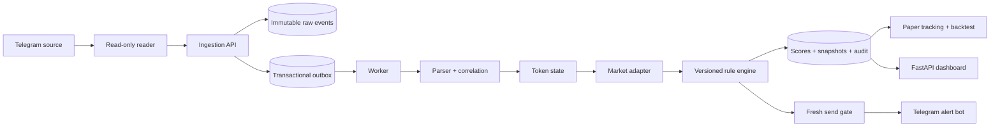
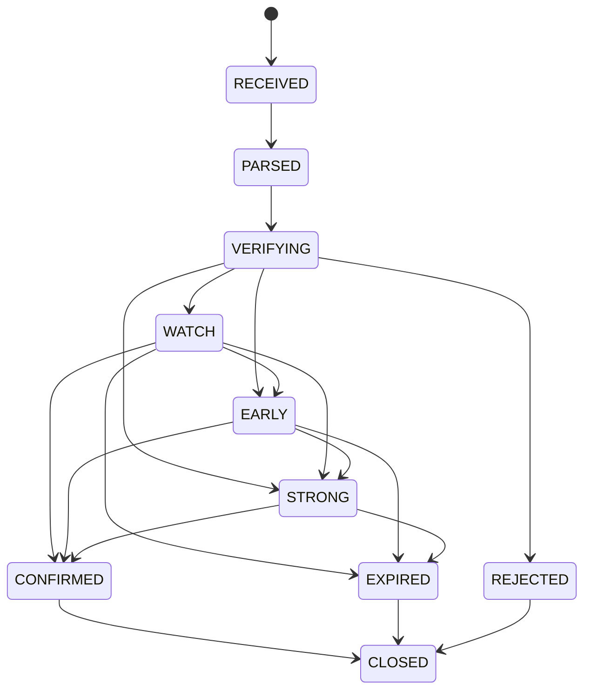

# Kiến trúc hệ thống

## Nguyên tắc

1. Event-time là nguồn thời gian duy nhất cho correlation/scoring; worker-time không được dùng để phân loại whale window.
2. Raw Telegram event được commit bất biến trước khi parser hoặc provider chạy.
3. Call giữ nguyên rule version lúc tạo. Rule published mới chỉ áp dụng call mới; shadow rule không gửi alert.
4. Score là hàm thuần. Live, simulation và backtest dùng cùng một hàm `evaluate`.
5. Mọi alert đi qua fresh market gate và anti-chase lần cuối.
6. Không có component giao dịch hoặc vật liệu ký giao dịch.

## Luồng dữ liệu

## Consistency và idempotency

- `raw_telegram_events`: unique `(source_id, source_message_id, event_kind, revision)`.
- `parsed_messages`: unique raw event + parser version.
- `whale_events` và `multiple_events`: unique raw event.
- `alerts`: unique token + level + destination.
- `outbox_events`: unique idempotency key; worker claim bằng `FOR UPDATE SKIP LOCKED`.
- Telegram timeout sau khi chuyển trạng thái `SENDING` được coi là ambiguous. Hệ thống không tự gửi lại để tránh spam; chuyển `MANUAL_REVIEW`.

## State machine

## Quyết định kỹ thuật

- Modular monolith thay vì microservices độc lập: cùng domain model, dễ tái lập backtest và giảm sai lệch phiên bản; các process vẫn scale riêng.
- PostgreSQL là source of truth cho cả dữ liệu nghiệp vụ và runtime state nhỏ có thể tái tạo.
- Bot API offset, webhook dedupe TTL và alert rate limit dùng bảng `runtime_state` với PostgreSQL upsert atomic.
- Async worker tự quản thay vì Celery; transactional outbox và worker coordination đều nằm trong PostgreSQL.
- Dashboard server-rendered static assets trong FastAPI để tránh thêm chuỗi cung ứng Node cho MVP.
- On-chain verification là opt-in. Helius webhook xác thực header, timestamp khi có, và dedupe signature/event hash.

## Scale và HA

API/worker/scheduler có thể chạy nhiều replica. Worker dùng row lock; scheduler task là idempotent theo capture reason. Khi cần HA production, đưa PostgreSQL sang managed service, chạy migration một lần, đặt API sau TLS ingress và giữ reader MTProto một active instance cho mỗi session.
